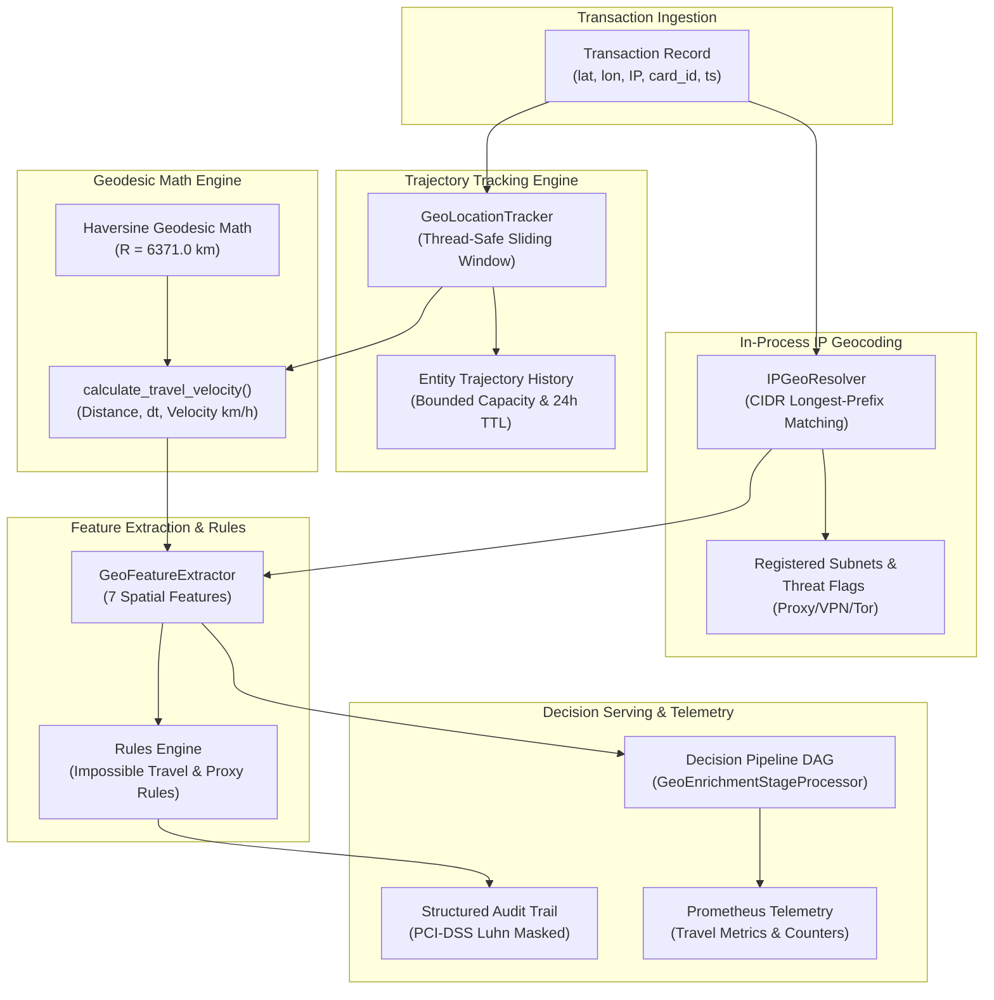
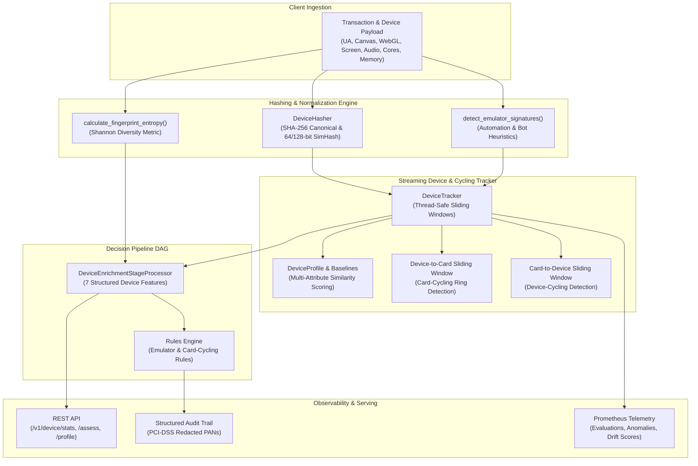
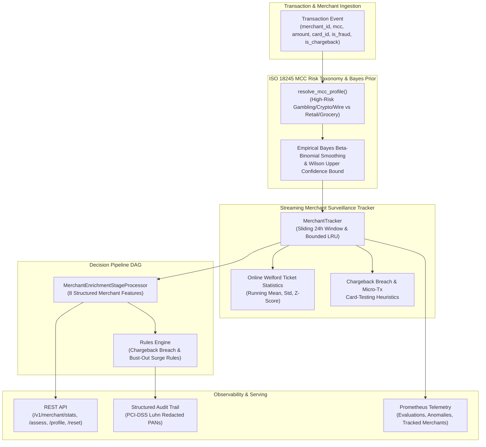
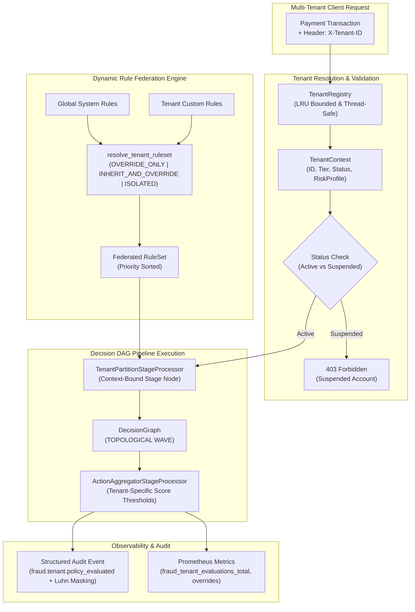
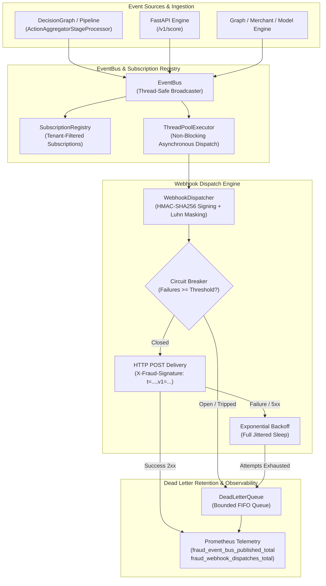

# Architecture

This document describes the boundaries that make the project reproducible and
safe to extend. The project is a reference implementation, not a complete
financial-services platform.

## Runtime flow

1. `data.py` loads CSV input, rejects ambiguous schemas and unsafe values, and
   exposes a `ValidatedDataset` containing numeric features and a binary target.
2. `model.py` performs stratified or temporal splitting, fits the selected
   estimator and calibration policy, chooses a validation-only threshold, and
   evaluates the untouched test split.
3. The fitted `FraudModel` owns feature ordering, probability validation,
   thresholded decisions, local explanations, metadata, and artifact loading.
4. `cli.py` orchestrates offline and operational workflows without duplicating model logic:
   training, comparison, scoring, monitoring, promotion evidence, model-card
   inspection, compliance rendering, historical audit replay, challenger retraining,
   machine-readable attestation export, multi-window drift surveillance, streaming
   profiling, and chaos simulation.
5. `api.py` adapts the same `FraudModel` to bounded FastAPI requests. Batch and
   single-transaction endpoints share one scoring helper with resilient serving
   guardrails (`fallback_mode`), degraded-state handling, an automated stateful
   `CircuitBreaker` (tracking failure counts and latency budgets), and non-blocking
   asynchronous challenger traffic shadowing (`shadow_model_path`).
6. `drift.py` compares current numeric distributions with the training profile,
   provides multi-window surveillance computing drift velocity and acceleration,
   tracks output prediction score drift via `ScoreProfile` and `calculate_score_drift`,
   and implements an online incremental `StreamingProfile` via Welford's algorithm.
   `evaluation.py` defines multi-tier decision routing (`DecisionAction`, `TieredThresholds`,
   `evaluate_tiered_policy`), automated decision tier calibration (`tune_tiered_thresholds`),
   counterfactual policy backtesting (`PolicyTransitionMatrix`, `backtest_policy_transition`),
   sub-population slice disparity diagnostics (`SliceMetricRow`, `evaluate_slices`),
   calibration analysis, and threshold reports;
   `reporting.py` renders promotion evidence as escaped, self-contained HTML.
7. `audit.py` exports thread-safe, structured JSONL audit events for scoring,
   shadowing, and promotion decisions with automated Luhn-validated PAN and sensitive key
   redaction guarantees, provides `replay_audit_log` for historical replay
   and divergence backtesting, and `backtest_audit_policy` for streaming counterfactual
   policy backtesting against audit logs.
8. `explanations.py` defines the `ExplanationProvider` boundary, keeping
   deterministic offline template explanations as default while wrapping external
   LLM calls with timeouts, prompt redaction, cost controls, and fallback.
9. `model.py` provides `generate_attestation` and `verify_attestation` to export
   and verify tamper-evident, canonical SHA-256 digested attestation manifests.
10. `edge.py` defines a versioned, dependency-light int8 runtime for the supported
    uncalibrated logistic artifact contract, providing quantized linear feature explanations
    (`explain_record`), multi-tier decision routing (`predict_decision_record`), and
    pure-Python streaming batch file scoring (`score_batch_file`). `cli.py` builds and
    validates this representation with `export-edge`; the runtime scorer itself does not
    import scikit-learn or pandas.
11. `telemetry.py` parses W3C `traceparent` contexts and provides an injectable
    trace exporter plus best-effort OTLP/HTTP JSON export. `api.py` creates one
    server span per HTTP request and isolates exporter failures from scoring.
12. `signing.py` owns Ed25519 key loading, canonical JSON signing, and trusted
    public-key verification. The CLI uses it to turn validation reports into
    deployment admission evidence without coupling signatures to inference.
13. `trust.py` validates rotation-aware public-key bundles, performs add/revoke
    operations, and exposes the admission check used by API startup. Revocation
    is evaluated before the model artifact is loaded.
14. `rules.py` defines declarative decision rule conditions, operators (`==`, `!=`, `>`, `>=`, `<`, `<=`, `in`, `not_in`), actions (`ALLOW`, `CHALLENGE`, `DENY`), priority evaluation, and serialization for `RuleSet`. `model.py` and `api.py` integrate rule sets with configurable precedence (`rules_override_model` vs `model_overrides_rules`), Prometheus instrumentation (`fraud_rules_triggered_total`), and structured audit logging.
15. `velocity.py` provides in-memory sliding window accumulators (`VelocityWindowBuffer`, `SlidingWindow`, `VelocityConfig`) tracking count, sum, min, max, mean, std, and exponential moving averages over configurable intervals with bounded $O(1)$ amortized insertion and eviction latency. It guarantees strict temporal causality without future-data leakage in both real-time streaming enrichment (`enrich_record_velocity`) and vectorized offline dataset transformations (`compute_batch_velocity`). `api.py` attaches velocity buffers to `create_app` with dedicated operational endpoints (`/v1/velocity/stats`, `/v1/velocity/profile/{entity_id}`) and Prometheus instrumentation (`fraud_velocity_enrichments_total`, `fraud_velocity_entities_active`).
16. `recalibration.py` provides model calibration surveillance and post-hoc recalibration diagnostics. It computes Expected Calibration Error (ECE), Maximum Calibration Error (MCE), Root Mean Squared Calibration Error (RMSCE), Brier score decomposition (reliability, resolution, uncertainty), reliability curve binning under uniform, quantile (equal frequency for imbalanced fraud data), and tiered partitioning strategies, and calibration drift detection (`CalibrationDriftReport`) with warning/alarm thresholds against baseline references. It implements three post-hoc recalibrators: Platt scaling (`PlattRecalibrator`) with monotonic $A \ge 0$ constraints and Laplace prior smoothing, isotonic regression (`IsotonicRecalibrator`) with monotonic step clipping, and temperature scaling (`TemperatureRecalibrator`) with rank-preserving probability sharpening/softening. `model.py` integrates recalibrators into `FraudModel`, offering `predict_probabilities(raw=True/False)` and `recalibrate_model` with automatic decision threshold retuning. `api.py` surfaces calibration status in `/health` and `/ready` probes, tracks `fraud_recalibrated_predictions_total` Prometheus metrics, and passes uncalibrated `raw_probability` through prediction results and audit events. `cli.py` exposes `calibrate-eval` and `recalibrate` commands.
17. `routing.py` defines champion/challenger multi-model routing (`ChampionChallengerRouter`, `RoutingPolicy`, `CanaryConfig`, `TrafficSplitStrategy`), deterministic entity hash stickiness across configurable entity keys (`card_id`, `user_id`, `transaction_id`), and automated canary safeguard surveillance (`RoutingMetricsTracker`, `DivergenceReport`) with automatic rollback. `api.py` integrates the router into `create_app`, exposing operational endpoints (`/v1/routing/status`, `/v1/routing/rollback`, `/v1/routing/reset`) and Prometheus metrics (`fraud_routing_predictions_total`, `fraud_shadow_discrepancy_total`, `fraud_canary_status`). Inferences run asynchronously in threadpool workers, and `cli.py` provides `route-eval` for offline and audit log divergence evaluation and safeguard threshold verification.
18. `features.py` defines typed feature store abstractions (`FeatureDefinition`, `FeatureType`, `FeatureView`, `FeatureSnapshot`), thread-safe storage engines (`InMemoryFeatureStore`, `FileFeatureStore`), point-in-time time-travel as-of joins (`point_in_time_join`) with zero lookahead bias guarantee ($t_{\text{feature}} \le t_{\text{observation}}$), and statistical training-serving skew surveillance (`FeatureSkewAnalyzer`, `FeatureSkewReport`, `FeatureSkewMetric`, `SkewStatus`) evaluating Population Stability Index (PSI), Kolmogorov-Smirnov (KS) statistic, Wasserstein distance, and null rate disparity. `audit.py` records enriched features and applied views in scoring audit events. `api.py` enriches incoming prediction requests from the feature store, exposes operational telemetry endpoints (`/v1/features/stats`, `/v1/features/lookup/{entity_key}/{entity_id}`), and exports Prometheus counters (`fraud_feature_lookups_total`). `cli.py` provides `feature-join` and `feature-check` commands and adds `--feature-store` to `serve`.
19. `pipeline.py` defines DAG-based execution of scoring decision workflows (`DecisionPipeline`, `PipelineStage`, `StageProcessor`), organizing stage dependencies into topologically ordered parallel execution waves via `asyncio.gather()`, with per-stage latency budgets, circuit breakers, node caching, speculative model inference, and fail-soft degradation.
20. `feedback.py` defines delayed ground truth label ingestion (`DelayedLabelRecord`, `LabelIngestionStore`), point-in-time audit log matching (`MatchedFeedbackRecord`, `match_feedback_with_audit_log`, `partition_feedback_cohorts`), empirical label maturation curve modeling (`LabelMaturationCurve`, `fit_maturation_curve`) to eliminate survivor bias and immature cohort distortions, realized performance and financial cost surveillance (`RealizedMetricsReport`, `compute_realized_metrics`), and automated retraining trigger policy evaluation (`RetrainingTriggerPolicy`, `FeedbackSurveillanceAnalyzer`). `audit.py` records structured delayed label and retraining trigger audit events. `api.py` exposes `/v1/feedback/labels`, `/v1/feedback/maturation`, and `/v1/feedback/surveillance` endpoints with Prometheus counters (`fraud_feedback_labels_ingested_total`, `fraud_feedback_matched_total`, `fraud_feedback_unmatched_total`, `fraud_feedback_retraining_triggers_total`) and gauges (`fraud_feedback_realized_recall`, `fraud_feedback_realized_pr_auc`, `fraud_feedback_realized_net_financial_loss`). `cli.py` provides `ingest-labels` and `feedback-surveillance` commands.
21. `geolocation.py` implements real-time geographic anomaly detection, spherical Haversine geodesic displacement math ($R = 6371.0\text{ km}$), speed-of-travel calculations (`TravelVelocity`, `calculate_travel_velocity`), streaming entity trajectory tracking (`GeoLocationTracker`) with thread-safe sliding-window temporal TTL eviction and capacity bounding, and in-process IP geocoding with CIDR prefix resolution and proxy/VPN/Tor classification (`IPGeoResolver`). `GeoFeatureExtractor` extracts 7 spatial features (`geo_distance_km`, `geo_speed_kmh`, `geo_time_delta_seconds`, `geo_is_impossible_travel`, `geo_is_cross_border`, `geo_is_proxy`, `geo_country_mismatch`). `rules.py` provides declarative decision heuristics (`build_impossible_travel_rule`, `build_geo_proxy_rule`), `pipeline.py` wires `GeoEnrichmentStageProcessor` into the decision DAG, `audit.py` captures structured PCI-DSS masked audit events (`build_impossible_travel_audit_event`), `api.py` exposes `/v1/geo/velocity/{entity_id}`, `/v1/geo/stats`, `/v1/geo/assess`, and `/v1/geo/reset` endpoints with Prometheus metrics (`fraud_geo_impossible_travel_total`, `fraud_geo_events_total`, `fraud_geo_distance_kilometers`), and `cli.py` provides `geo-velocity` and `geo-enrich` workflows.

## Artifact contract

An artifact directory contains:

```text
manifest.json   SHA-256 digests for model.joblib and metadata.json
metadata.json   JSON model card, schema, metrics, profile, and lineage
model.joblib    trusted-process pickle containing the fitted FraudModel
```

`save_model` writes temporary files and replaces the final files only after the
metadata and manifest are complete. `load_model` verifies the manifest before
deserialization, checks the scikit-learn runtime, validates the embedded model,
and confirms that embedded and readable metadata agree.

An edge export is a separate JSON artifact and is not a replacement for the trusted
`model.joblib` artifact:

```text
schema_version       Edge format version (currently 1)
feature_names        Ordered numeric input contract
scaler_mean/scale    Standardization statistics
quantized_weights    Signed int8 logistic coefficients
weight_scale         Coefficient dequantization scale
intercept/threshold  Decision policy values
pruned_features      Coefficients removed by the export policy
```

Only `logistic_regression` artifacts with `calibration_method=none` are exportable.
The edge loader validates the schema, exact feature mapping, finite numeric values,
positive scaler scales, and int8 bounds. The exporter can compare edge and source
probabilities against validation data and refuses output when the configured error
tolerance is exceeded. The JSON runtime is suitable for a constrained scorer, but
the source model remains authoritative for retraining, audit replay, and calibrated
probability reporting.

`validate_artifact` (and the `validate-artifact` CLI command) provides a
safe, read-only validation pass verifying manifest integrity, runtime
compatibility, lineage completeness, and report readiness prior to deployment.

The lineage block on newly trained artifacts contains:

- `dataset_fingerprint`: SHA-256-derived fingerprint of feature and target data;
- `config_hash`: SHA-256 of the canonical training configuration;
- `code_version`: package version used by the training process;
- `content_hash`: deterministic hash over dataset, configuration, and code
  version;
- optional `git_commit` and `git_repository` values from CLI training.

Artifact validation reports can be exported as machine-readable JSON attestation
manifests via `generate_attestation()` / `validate-artifact --attestation-output`,
providing a verifiable SHA-256 digest over the full verification state for admission
controllers. The digest detects payload modification but does not establish who
produced the attestation.

The optional authenticity layer works as follows:

- `generate-signing-key` writes a self-describing Ed25519 private PEM and a public PEM key
  using atomic replacement. Private output is never printed or included in an
  attestation.
- `validate-artifact --strict --signing-key ... --attestation-output ...` adds a
  `signature` envelope. The signature covers the complete payload after the
  SHA-256 `attestation_digest` is attached.
- `verify-attestation` independently loads a pinned public key, validates the
  digest, verifies the Ed25519 signature, and requires `status=PASSED` by default.
  It exits `1` for any failed admission condition.

Unsigned attestations remain digest-verifiable for backward compatibility, but
deployment admission must keep the required-signature default. Public keys are
trust anchors and must come from access-controlled deployment configuration
rather than from the attestation being verified.

Lineage is additive. Artifacts created before lineage was introduced remain
loadable, but their model cards identify the missing provenance.

## Serving boundary

`create_app` receives an already trusted model or resolves one from
`FRAUD_MODEL_PATH` at startup. It applies request-size limits, strict finite
numeric validation, optional API-key and in-memory rate limiting middleware
(configurable through `FRAUD_API_KEYS`, `FRAUD_RATE_LIMIT_REQUESTS`,
`FRAUD_RATE_LIMIT_WINDOW_SECONDS`, and matching `serve` options) that exempt
`/health`, `/live`, `/ready`, and `/metrics`, request correlation headers,
structured logging, opt-in JSONL audit event export
(`FRAUD_AUDIT_LOG_PATH`), pluggable explanation providers, and isolated Prometheus
metrics. Model inference and audit-sink writes run through Starlette's
threadpool so CPU- and I/O-bound scoring never blocks the event loop that
serves probes and other requests, and API keys are compared with
`secrets.compare_digest` across every configured value. An optional
`max_concurrent_scoring` semaphore (default off, also settable via
`FRAUD_MAX_CONCURRENT_SCORING` and `serve`) returns `503` with `Retry-After`
when the cap is reached instead of queueing unbounded work. Dedicated probes
expose process liveness (`/live`) and scoring-path
readiness (`/ready`, HTTP 503 when the model is missing or the circuit is open
with `fallback_mode=raise`). It also returns a W3C `traceparent` response header and can export request
spans through an injected `TraceExporter` or optional OTLP/HTTP collector configured
with `OTEL_EXPORTER_OTLP_TRACES_ENDPOINT`, `OTEL_SERVICE_NAME`, and
`FRAUD_OTLP_TIMEOUT_SECONDS`. Trace export is disabled by default, sends only
operational attributes (method, path, status, request ID, and model version), and
contains no transaction features. Exporter/network failures are isolated from
requests. Serving guardrails support degraded-state fallback policies (`constant`,
`rule`, `raise`) configurable via environment variables or header simulation
(`X-Simulate-Degraded`), with fallback executions tracked by Prometheus counters
(`fraud_fallback_predictions_total`). Authentication, network policy, durable
rate limiting, collector authentication, secret management, trace retention, and
audit-log retention remain deployment responsibilities. When both
`FRAUD_ATTESTATION_PATH` and `FRAUD_TRUST_BUNDLE_PATH` are configured, startup
first verifies the attestation digest, `PASSED` status, signing key ID, active
bundle status, and Ed25519 signature; only then does it deserialize the model.
Partial admission configuration or failed verification stops startup.

## Distribution boundary

GitHub Actions builds the wheel and source distribution once per release workflow.
The release candidate wheel is installed before CycloneDX generates the
`sbom/sbom.cdx.json` artifact, so the recorded dependency inventory describes
what is being published rather than an unrelated source-only environment. CI
also installs that wheel from outside the checkout and runs the versioned CLI.
TestPyPI uses `skip-existing` only for immutable already-uploaded development
files; build, metadata, and SBOM failures remain fatal. PyPI and TestPyPI
publishing authenticate through OIDC trusted publishers, which are deployment
configuration rather than application code.

For operational resiliency and safe challenger evaluation:
- `CircuitBreaker` maintains scoring stability. Consecutive failures exceeding
  `failure_threshold` or execution times exceeding `latency_budget_ms` trip the
  breaker from `CLOSED` to `OPEN`, failing over immediately to fallback policies
  until `recovery_timeout` elapses, after which a `HALF_OPEN` probe test determines
  recovery. State transitions are synchronized with a lock across concurrent threadpool
  workers. Breaker state is tracked via `/health` telemetry and Prometheus
  (`fraud_circuit_breaker_state`).
- Asynchronous traffic shadowing evaluates transactions against `shadow_model_path`
  on detached background tasks outside the ASGI request lifecycle without blocking,
  delaying primary client responses, or holding connections open, recording
  prediction discrepancies and latency metrics (`fraud_shadow_evaluations_total`)
  to structured audit logs.

The API does not retrain or mutate a model. Threshold overrides are explicit in
the request and response, while the tuned artifact threshold remains visible as
`model_threshold`.

## Evaluation invariants

- The validation split owns threshold and model-selection decisions.
- The test split is untouched until final evaluation.
- Temporal evaluation sorts by the configured time feature and rejects
  single-class windows.
- Temporal gaps enforce holdout separation to mirror label delay (chargeback maturation)
  without unconfirmed labels leaking into training windows.
- Calibration is fit inside training data and is never fitted on holdout data.
- Drift is a diagnostic signal; it is not treated as proof of changed model
  quality without labels and business context.
- Explanations isolate external model calls behind timeouts, redactions, cost
  controls, and deterministic fallbacks.
- Compliance reports assemble evidence and never make an automatic promotion
  decision.

## Operational surveillance & safety invariants

- Multi-window drift analyzes both recent short windows and baseline long windows
  to compute velocity ($\Delta \text{PSI}$) and acceleration ($\Delta^2 \text{PSI}$),
  detecting distribution shifts early without waiting for full batch cycles.
- Streaming profile accumulation updates feature distributions incrementally
  using Welford's algorithm, keeping memory constant regardless of stream length.
- Traffic shadowing runs on detached tasks outside the ASGI request lifecycle,
  never blocking, delaying, or failing primary scoring responses.
- Caller-input schema mismatches return `422` immediately and do not affect
  circuit-breaker health or trip fallback policies.
- Prometheus request metrics are labeled with matched route templates, collapsing
  undeclared paths into `'unmatched'` to prevent label cardinality explosion.
- Circuit breakers fail fast to safe deterministic fallback policies when upstream
  or model degradations occur.
- Trace propagation preserves a valid incoming W3C trace ID while creating a new
  server span ID; malformed contexts start a fresh trace.
- OTLP collection is optional and best effort. It must never become a scoring
  availability dependency.
- Output score drift surveillance evaluates prediction probabilities against baseline
  validation profiles using Population Stability Index (PSI) without requiring labels,
  tripping alerting webhooks when distributions deviate.
- Multi-tier decision routing adheres strictly to $0 \le review\_threshold \le deny\_threshold \le 1.0$,
  ensuring transactions cannot simultaneously qualify for both ALLOW and DENY actions.
- Post-hoc probability recalibrators enforce monotonicity ($A \ge 0$ for Platt scaling, non-decreasing step functions for isotonic regression, and rank-preserving temperature scaling), guaranteeing that calibrated risk scores never invert predicted class rankings.
- Recalibration surveillance monitors reliability calibration drift against baseline curves, alerting operational teams when ECE degradation exceeds configured warning or alarm tolerances.
- Multi-model canary routing protects production scoring via automated discrepancy and probability divergence safeguards; exceeding safety thresholds automatically halts Challenger traffic and executes zero-latency rollback to Champion inference.
- Entity hash routing guarantees deterministic model stickiness across transactions for the same entity key, preventing alternating model decisions during rolling canary deployments.
- Point-in-time feature store as-of joins strictly enforce temporal causality ($t_{\text{feature}} \le t_{\text{observation}}$), eliminating future target leakage in offline training set generation.
- Training-serving feature skew surveillance monitors feature distribution drift across serving traffic against training baselines, evaluating PSI, Kolmogorov-Smirnov test, and Wasserstein distance with configurable drift thresholds and automated safeguard exit codes.
- Decision graph DAG execution organizes stage dependencies into topologically ordered parallel execution waves, executing concurrent non-interdependent stages (e.g. feature store lookups and heuristic rules) via `asyncio.gather()`.
- Per-stage latency budgets and fail-soft degradation guarantee pipeline resilience; when non-required stages (enrichment, recalibration, explainability) time out or fail, they fall back to pre-configured safe outputs and flag `degraded=True`, allowing final action arbitration to complete within SLA.
- Full execution tracing records complete pipeline DAG lineage, stage durations, and degraded node lists in structured audit events and Prometheus telemetry (`fraud_pipeline_stage_duration_seconds`, `fraud_pipeline_executions_total`).
- Stage node caching keeps a bounded in-memory LRU per node with TTL expiry; cache keys are derived deterministically from the transaction (or configured key columns), so a hit returns exactly what the processor would have produced for identical inputs. Only pure stages are cached by default (rules); model inference caching is opt-in.
- Speculative model inference starts the inference stage concurrently with upstream enrichment on the pre-enrichment transaction. The speculative result is adopted only when the model's feature values are unchanged after enrichment and no rule short-circuit occurred; otherwise it is cancelled and the stage is recomputed, so speculation never changes the decision, only latency. Outcomes are recorded as `speculative_executed` / `speculative_hit` in results, audit events, and Prometheus counters.
- Dynamic decision graph replay (`replay_audit_log_through_pipeline`) evaluates historical JSONL scoring audit logs against candidate DAG configurations (incorporating updated rules, rule precedence, recalibrators, and tiered thresholds), tracking probability divergence, 3×3 decision turnover matrices (`ALLOW`, `CHALLENGE`, `DENY`), and stage-by-stage execution latency distributions (`mean_ms`, `p95_ms`).
- Counterfactual policy optimization (`optimize_counterfactual_pipeline`) quantifies decision turnover, review queue workload shifts, deny volume deltas, and expected financial cost differentials across candidate tiered policies prior to production rollout.
- Decision graph stage circuit breakers provide thread-safe fast-fail isolation per stage. Each stage circuit breaker implements a three-state finite state machine (`CLOSED`, `OPEN`, `HALF_OPEN`) tracking consecutive failure thresholds and recovery timeout cooldowns. When a stage trips `OPEN`, calls short-circuit immediately without executing processor logic, returning pre-configured safe fallbacks with `StageStatus.CIRCUIT_OPEN`, flagging `degraded=True`, and recording the short-circuit in audit logs and Prometheus telemetry (`fraud_pipeline_circuit_short_circuits_total`).
- Deterministic stage chaos fault injection (`simulate_pipeline_chaos`) enables resilience testing by injecting controlled faults (latency spikes, transient exceptions, payload corruption, and timeouts) into target pipeline stages using seedable pseudo-random distributions. Evaluates degraded execution rates, circuit trips, stage short-circuits, and strict SLA breach budgets (`sla_budget_ms`) while generating structured audit events and Prometheus counters (`fraud_pipeline_chaos_injections_total`).
- Delayed ground-truth feedback ingestion operates thread-safely with append-only stores (`LabelIngestionStore`), supporting multi-source label aggregation (chargebacks, merchant disputes, manual fraud analyst reviews, confirmed non-fraud clears) and point-in-time join matching against immutable JSONL scoring audit logs via transaction ID.
- Empirical label maturation curve modeling (`LabelMaturationCurve`) estimates cumulative delay CDFs and quantiles ($p_{50}, p_{75}, p_{90}, p_{95}, p_{99}$) across chargeback arrival intervals. Cohorts younger than the configured maturity threshold (e.g. $p_{90}$ or 90% label maturity fraction) are filtered from primary performance evaluation to prevent optimistic survivor bias and premature false alarm triggers.
- Realized surveillance calculates performance metrics (precision, recall, F1, PR-AUC, ROC-AUC, Brier score) and business financial metrics (net financial loss, fraud loss avoided, false positive friction cost, net ROI) exclusively on mature transaction cohorts.
- Automated retraining trigger policies enforce rigorous composite criteria (requiring minimum mature transaction counts and minimum confirmed fraud incidents before evaluation) and threshold checks across recall degradation, PR-AUC drops, cost surges, and sustained feature drift, emitting structured audit events and non-zero CLI exit codes (`EXIT_CODE_RETRAIN_TRIGGERED = 3`) to initiate downstream automated re-training pipelines.
- Automated closed-loop retraining dataset materialization (`RetrainingDatasetBuilder`) joins mature ground-truth dispute feedback with immutable production scoring audit logs, enforcing temporal ordering, holdout purge buffers, capacity assertions, and multi-class verification without future data leakage.
- Automated challenger training and tuning (`ChallengerTrainer`) maps hyperparameter configurations, executes cross-validation splitting, optimizes decision thresholds for cost minimization or F1, and captures complete training duration and lineage metadata.
- Multi-faceted challenger safety verification (`ChallengerSafetyVerifier`) evaluates challenger candidates against active production champions on identical holdout data across composite safety gates: minimum PR-AUC delta ($\ge -0.02$), recall non-regression ($\ge -0.03$), maximum calibration error increase ($\Delta \text{ECE} \le 0.03$), financial cost differential ($\le 5\%$), and sub-population slice disparity ($\le 0.25$).
- Cryptographic candidate attestation and lineage signing (`export_certified_candidate`, `verify_certified_candidate`) seals candidate artifacts with canonical JSON manifests, SHA-256 digests, and Ed25519 digital signatures, preventing tampered or uncertified models from loading into production.
- Zero-downtime hot-reloading (`POST /v1/models/reload`) and dynamic canary promotion (`POST /v1/models/promote`) perform thread-safe in-memory model swaps, adjusting canary traffic splits or promoting candidates to primary champion without process restarts, connection drops, or scoring interruption.
- Automated retraining CLI orchestration (`fraud-detect auto-retrain`) provides end-to-end execution with deterministic exit code gating ($0=\text{Success}$, $1=\text{Runtime Error}$, $2=\text{Config Error}$, $3=\text{Candidate Rejected by Safety Gates}$) to safely integrate into automated orchestrators (Airflow, Kubeflow, GitHub Actions).
- Real-time bipartite entity-transaction link graph (`EntityGraph`) maintains an in-memory streaming bipartite topology mapping discrete entities (`card_id`, `device_id`, `ip_address`, `merchant_id`, `user_id`, `session_id`, `terminal_id`) to transaction nodes with $O(1)$ adjacency lookups, sliding temporal window eviction, thread safety (`RLock`), and hard capacity capping.
- Graph feature extraction (`GraphFeatureExtractor`) strictly enforces zero lookahead bias by extracting structural centrality, degree, and 2-hop entity sharing counts computed strictly before candidate transaction ingestion.
- Personalized PageRank risk diffusion propagates empirical fraud risk scores through the 2-hop bipartite entity network using bounded power iteration with configurable damping ($\alpha=0.85$) and iterations ($k=5$), surfacing hidden synthetic identity links and collusion syndicates.
- Automated topological fraud ring detection (`FraudRingDetector`) discovers dense bicliques (cards cycling across shared devices/IPs), high-frequency card-testing botnet attacks, and circular flow cycles, assigning severity ratings (`CRITICAL`, `HIGH`, `MEDIUM`, `LOW`) and recommended mitigation actions (`ALLOW`, `CHALLENGE`, `DENY`).
- Pipeline integration (`GraphEnrichmentStageProcessor`) enriches real-time decision graph transactions with 26+ link features, enabling downstream rules (`build_fraud_ring_rule`) to trigger immediate challenges or denies.
- Redacted audit trail logging (`build_fraud_ring_detected_audit_event`) emits structured audit records with automated PCI-DSS compliant PAN masking for all credit card identifiers.
- Prometheus graph telemetry tracks active entity counts by type (`fraud_graph_nodes_total`), total edges (`fraud_graph_edges_total`), detected syndicate counts by severity (`fraud_graph_rings_detected_total`), and ring detection latency histograms (`fraud_graph_ring_detection_seconds`).
- Real-time geographic geolocation anomaly detection and velocity speed-of-travel tracking (`GeoLocationTracker`, `calculate_travel_velocity`) enforces zero-lookahead temporal causality and spherical Haversine geodesic displacement math, detecting impossible physical travel anomalies ($v > 900\text{ km/h}$) and high-risk proxy/VPN/Tor egress nodes.
- Thread-safe sliding temporal window trajectory tracking evicts stale locations beyond the configured TTL window (default 24h) and bounds maximum entity capacity, preventing memory leaks in high-throughput streaming environments.
- In-process IP geocoding (`IPGeoResolver`) performs deterministic longest-prefix CIDR matching against registered subnets without external network calls or binary database dependencies, resolving geographic coordinates and threat flags (`is_proxy`, `is_vpn`, `is_tor`).
- Structured audit event emission (`build_impossible_travel_audit_event`) guarantees PCI-DSS compliant Luhn-validated PAN masking and sensitive data redaction across impossible travel incident records.
- Pipeline integration (`GeoEnrichmentStageProcessor`) enriches real-time decision graph transactions with 7 spatial features, allowing downstream rules (`build_impossible_travel_rule`, `build_geo_proxy_rule`) to trigger immediate transaction challenges or denies.
- Prometheus geolocation metrics track impossible travel incidents (`fraud_geo_impossible_travel_total`), processed spatial events (`fraud_geo_events_total`), and geodesic displacement histograms (`fraud_geo_distance_kilometers`).
- Real-time adaptive device and browser fingerprinting subsystem (`DeviceFingerprint`, `ScreenGeometry`, `DeviceHasher`, `DeviceTracker`) provides deterministic canonical SHA-256 and locality-sensitive SimHash computation for fuzzy device clustering and drift detection.
- Multi-attribute composite similarity calculation (`calculate_fingerprint_similarity`) weights hardware concurrency, memory ratios, screen dimensions, WebGL vendor/renderer strings, Canvas/Audio hashes, and OS/browser families into a calibrated stability score in $[0.0, 1.0]$.
- Thread-safe sliding temporal window device tracking (`DeviceTracker`) detects card cycling (multiple cards on one device) and device cycling (multiple devices on one card) across a configurable lookback window with bounded LRU eviction.
- Automated emulator and bot detection heuristics (`detect_emulator_signatures`) inspect user agents for headless automation frameworks (HeadlessChrome, Puppeteer, Selenium, Playwright), explicit webdriver flags, unrealistic hardware configurations, and desktop environments lacking WebGL/Canvas contexts.
- Shannon entropy scoring (`calculate_fingerprint_entropy`) calculates information-theoretic diversity scores over normalized attribute distributions, identifying low-entropy synthetic or automated browser profiles.
- Pipeline graph integration (`DeviceEnrichmentStageProcessor`) enriches real-time decision graph transactions with 7 device features, enabling downstream rules (`build_device_emulator_rule`, `build_device_card_cycling_rule`) to trigger immediate challenges or denies.
- Redacted audit trail logging (`build_device_anomaly_audit_event`) emits structured audit records with automated PCI-DSS compliant PAN masking for all credit card numbers.
- Prometheus device telemetry tracks total device evaluations (`fraud_device_evaluations_total`), detected anomalies by severity (`fraud_device_anomalies_total`), and composite fingerprint similarity histograms (`fraud_device_similarity_score`).
- Real-time merchant and ISO 18245 MCC risk profiling (`MCCRiskProfile`, `resolve_mcc_profile`, `MerchantTracker`) computes Empirical Bayes (Beta-Binomial) credibility-smoothed fraud rates ($\hat{p} = \frac{f + m \cdot p_0}{n + m}$) and Wilson score upper confidence bounds, preventing zero-volume division variance on newly onboarded terminals while rapidly escalating established high-chargeback merchants.
- Online Welford ticket-size statistics (`_update_welford`) maintain running mean and variance accumulators per merchant in $O(1)$ space, detecting sudden terminal bust-out surges ($Z > 3.0$) and micro-transaction card-testing enumeration ($\ge 50\%$ micro-transactions across $\ge 5$ distinct cards).
- Pipeline graph integration (`MerchantEnrichmentStageProcessor`) enriches real-time decision graph transactions with 8 merchant features (`merchant_tx_count_24h`, `merchant_smoothed_fraud_rate`, `merchant_mcc_risk_score`, `merchant_amount_zscore`, `merchant_distinct_cards_24h`, `merchant_micro_tx_ratio`, `merchant_is_high_chargeback`, `merchant_is_bust_out_surge`), enabling downstream rules (`build_merchant_chargeback_rule`, `build_merchant_bust_out_rule`) to trigger immediate challenges or denies.
- Redacted audit trail logging (`build_merchant_anomaly_audit_event`) emits structured `fraud.merchant.anomaly_detected` records with automated PCI-DSS compliant Luhn PAN masking, and Prometheus merchant telemetry tracks evaluations (`fraud_merchant_evaluations_total`), anomalies (`fraud_merchant_anomalies_total`), and active tracked merchants (`fraud_merchant_tracked_merchants_total`).
- Multi-tenant policy partitioning (`TenantContext`, `TenantRiskProfile`, `TenantRegistry`) enables secure multi-organization payment processing and SaaS fraud gateway hosting with strict account isolation, tenant-specific risk profiles (`decline_threshold`, `challenge_threshold`, `review_threshold`, `max_amount_per_tx`), custom velocity limits, and metadata tags.
- Dynamic rule federation (`resolve_tenant_ruleset`) dynamically merges baseline system rules with organization-level declarative rules across three inheritance modes: `OVERRIDE_ONLY`, `INHERIT_AND_OVERRIDE`, and `ISOLATED`, resolving priority order and rule collisions deterministically.
- Thread-safe tenant registry (`TenantRegistry`) manages runtime tenant onboarding and lifecycle states (`ACTIVE`, `SUSPENDED`, `DEPRECATED`), supporting bounded LRU memory eviction, strict isolation enforcement, and atomic manifest export/import.
- Pipeline graph integration (`TenantPartitionStageProcessor`) binds active tenant context to Decision DAG evaluation without cross-tenant state leakage, dynamically injecting tenant thresholds and rule actions into `ActionAggregatorStageProcessor`.
- Redacted audit trail logging (`build_tenant_audit_event`) emits structured `fraud.tenant.policy_evaluated` audit records with PCI-DSS compliant Luhn-validated PAN masking and sensitive credential redaction.
- REST API and Prometheus observability provide tenant resolution (`X-Tenant-ID` header), tenant management endpoints (`/v1/tenants/*`), suspended 403 enforcement, and tenant telemetry (`fraud_tenant_evaluations_total`, `fraud_tenant_rule_overrides_total`).


## Real-Time Geolocation & Velocity Travel Subsystem




## Adaptive Device & Browser Fingerprinting Subsystem




## Real-Time Merchant & MCC Risk Profiling Subsystem



## Multi-Tenant Policy Partitioning & Dynamic Rule Federation Subsystem




## Asynchronous Real-Time Event Bus & Streaming Webhook Dispatcher

The fraud detection engine includes a zero-dependency, in-process asynchronous streaming event bus and resilient webhook dispatch system (`events.py`). This allows multi-tenant payment gateways, downstream fraud analyst portals, and external alerting systems to subscribe to transaction verdicts, graph fraud rings, merchant anomalies, and model promotions without introducing latency overhead into online scoring paths.



### Key Components

- **Domain Event Taxonomy (`EventType`)**: Typed domain events across the fraud detection lifecycle (`fraud.transaction.scored`, `fraud.decision.denied`, `fraud.graph.ring_detected`, `fraud.merchant.anomaly_detected`, `fraud.geo.anomaly_detected`, `fraud.model.promoted`, etc.).
- **HMAC-SHA256 Signature Verification**: All webhook notifications include an `X-Fraud-Signature: t={timestamp},v1={hex_digest}` header computed over the serialized payload to ensure integrity and prevent replay attacks within a 300-second window.
- **PCI-DSS PAN Redaction**: Domain events and webhook envelopes automatically pass through Luhn PAN masking and credential redaction, preventing cardholder data leakage.
- **Circuit Breaker & Exponential Backoff**: Webhook destinations experiencing repeated server errors are quarantined by an automatic circuit breaker (`circuit_breaker_failure_threshold=5`, `recovery_seconds=30.0`), with intermediate attempts scheduled via exponential backoff with full jitter.
- **Dead-Letter Queue (DLQ)**: Undeliverable notifications are preserved in a thread-safe, bounded in-memory buffer (`DeadLetterQueue`) for inspection and on-demand replay via CLI or API.


## Extension guidance


New estimators should be added through `EstimatorType` and `_build_base_estimator`
so calibration, splitting, evaluation, artifact validation, and explanations
remain shared. New reports should expose a serializable payload builder in the
relevant domain module and keep rendering/orchestration in `cli.py` or
`reporting.py`. New API fields should be additive where possible and covered by
request-validation and response tests.
